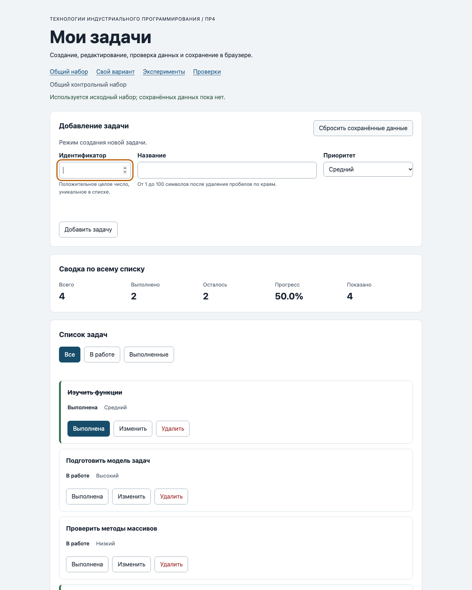

# Практическая работа № 4. Формы, валидация и локальное хранение данных

## Данные работы

| Поле | Значение |
|---|---|
| Имя | Бачинский Даниэль Денисович |
| Группа | ЭФБО-06-25 |
| Вариант из ПР2–ПР3 | 4 (подготовка семинара) |
| Node.js | v24.21.0 (npm 11.19.0) |
| Git | 2.50.1 (Apple Git-155) |
| Браузер | Chromium 156.0.8078.75 (встроенный браузер), Google Chrome headless — снимок экрана |
| Операционная система | macOS Tahoe 26.6.2 |

## Запуск

Рабочая папка: `practice-04` внутри личного репозитория.

```bash
npm test
npm start
```

Устанавливать зависимости через `npm install` не требуется.

```text
http://127.0.0.1:5504/
http://127.0.0.1:5504/index.html?dataset=variant
http://127.0.0.1:5504/examples/forms-storage.html
http://127.0.0.1:5504/checks.html
```

Использовался порт по умолчанию 5504.

## Перенос результата ПР3

Перед изменениями `npm run check:service` на перенесённом коде дал 35 из 35 — исправлений в функциях ПР2–ПР3 не потребовалось.

| Файл | Что перенесено или изменено |
|---|---|
| `data.js` | Скопирован из ПР3 без изменений: общий набор и шесть задач варианта 4 (`variantNumber = 4`). |
| `task-service.js` | Скопирован из ПР3; добавлена функция `updateTask`. Остальные функции не менялись. |
| `task-selectors.js` | Скопирован из ПР3 без изменений (`all` / `pending` / `completed`). |
| `task-view.js` | Скопирован из ПР3; в карточку добавлена третья кнопка `button[type=button][data-action="edit"]` с `span.action-label` «Изменить» между `toggle` и `delete`. Название по-прежнему выводится через `textContent`. |

`main.js` из ПР3 не копировался: в новый `main.js` перенесены тела `renderApp`, `handleFilterClick` и `handleTaskListClick` и дописаны форма, хранение и сброс.

## Эксперименты с формой и хранилищем

Страница `examples/forms-storage.html`.

| № | До запуска: прогноз | После запуска: результат | Объяснение |
|---:|---|---|---|
| 1. Пустое обязательное поле | `submit` не произойдёт, браузер покажет своё сообщение | Обработчик `submit` не вызвался (счётчик 0), журнал не изменился: «Действия ещё не выполнялись.»; `validity.valid = false`, `validationMessage = "Заполните это поле."` | Браузер проверяет `required` до события `submit` и блокирует отправку. |
| 2. Название из пробелов | `required` пропустит, отклонит прикладная проверка | `submit` произошёл; журнал: «submit получен, но прикладная проверка отклонила значение.»; после `setCustomValidity` у поля `validity.valid = false`, `customError = true` | Для `required` строка `"   "` непустая. Правило «после `trim` не пусто» — прикладное. `setCustomValidity(text)` делает поле невалидным, пока на `input` не вызвать `setCustomValidity("")`. |
| 3. Типы значений `FormData` | Значения — строки, `defaultPrevented = true`, название без пробелов | `submit.defaultPrevented: true`, `typeof FormData title: string`, `typeof localStorage value: string`; `"  Семинар  "` → `{"title":"Семинар","priority":"high"}` | `FormData` возвращает строки; `preventDefault()` отменяет отправку, но обработчик продолжает работу; `trim` выполнен в коде. |
| 4. Строка в `localStorage` и JSON | `getItem` вернёт строку, `JSON.parse` — объект | `raw: "{\"title\":\"Семинар\",\"priority\":\"high\"}"`, `parsed: { title: "Семинар", priority: "high" }` | В хранилище лежит только строка; объект восстанавливается разбором JSON. |
| 5. Повреждённый JSON | `JSON.parse` выбросит исключение | «JSON.parse завершился ошибкой: Expected property name or '}' in JSON at position 1 (line 1 column 2)», `raw: "{broken-json"` | Без `try/catch` такое исключение остановило бы запуск приложения. После эксперимента учебный ключ удалён кнопкой «Удалить ключ». |

## Организация кода

| Файл | Ответственность |
|---|---|
| `task-service.js` | Чистые операции над массивом задач (`addTask`, `updateTask`, `setTaskCompleted`, `removeTask` …). Не трогает DOM и storage, вход не изменяет. |
| `form-validation.js` | `validateTaskDraft` — нормализация (`Number`, `trim`) и проверка черновика формы; возвращает `{ ok, value }` или `{ ok: false, errors }` по полям. Без `document`. |
| `task-storage.js` | Граница `localStorage`: проверка схемы (`isValidTaskList`), `loadTasks`, `saveTasks`, `removeSavedTasks`. Все исключения перехватываются и превращаются в `{ ok: false, error }`. |
| `task-view.js` | Создание карточек, списка, сводки и пустого состояния. Без обработчиков и записи данных. |
| `main.js` | Состояние (`currentTasks`, `currentFilter`, `editingId`), режим формы, обработчики событий, вызовы сервиса и сохранения. |

Функции хранения получают `storage` аргументом: так видно внешнюю зависимость, и модуль проверяется в Node.js объектом-имитацией (`MemoryStorage`, объекты с бросающим `setItem`). Данные из JSON проверяются до использования, потому что успешный `JSON.parse` подтверждает только синтаксис: внутри может быть другая версия, строковый `completed`, повтор id. Некорректная запись отклоняется целиком — используется копия исходного набора и показывается предупреждение.

## Проверка формы

| Сценарий | Ожидаемый результат | Фактический результат | Итог |
|---|---|---|---|
| Добавление корректной задачи | Задача добавлена, форма очищена, запись в storage | `20, "Изучить localStorage", high` → id `[1, 4, 7, 10, 20]`, ключ содержит 5 задач | Да |
| Повторяющийся id | Отказ без изменения списка | id `4`: ошибка «Задача с id = 4 уже существует», `aria-invalid="true"`, список и запись не изменились | Да |
| Пустое название | Отказ | Пустая форма: `submit` заблокирован нативно (`task-id.validity.valid = false`, `task-title.validity.valid = false`), ключ отсутствует | Да |
| Название из пробелов | Отказ прикладной проверки | `"   "`: «Название не должно быть пустым или состоять из пробелов», список не изменился | Да |
| Название длиной 100 | Успех | Задача 21 добавлена, длина названия 100 | Да |
| Название длиной 101 | Отказ | Значение задано программно (обходит `maxlength`): «Название должно быть не длиннее 100 символов», задача 22 не добавлена | Да |
| Редактирование title и priority | Меняется одна задача, статус сохраняется | id 4 → `{"id":4,"title":"Подготовить форму задач","completed":false,"priority":"low"}`; выполненная задача 1 в браузерной проверке осталась `completed: true` | Да |
| Отмена редактирования | Возврат к пустой форме создания | Заголовок «Добавление задачи», поля пустые, id разблокирован, кнопка отмены скрыта, фокус в поле id | Да |
| Удаление редактируемой задачи | Форма возвращается в режим создания | Редактирование 7 → удаление 7: список `[1, 4, 10, 21]`, заголовок «Добавление задачи» | Да |

## Общий сценарий

| Шаг | Действие | Видимые id | Всего | Выполнено | Осталось | Прогресс | Состояние storage |
|---:|---|---|---:|---:|---:|---:|---|
| 0 | Исходный запуск после сброса | `[1, 4, 7, 10]` | 4 | 2 | 2 | 50.0% | ключ отсутствует |
| 1 | Добавление `id = 20` | `[1, 4, 7, 10, 20]` | 5 | 2 | 3 | 40.0% | tasks `[1, 4, 7, 10, 20]` |
| 2 | Отказ для повторного `id = 4` | `[1, 4, 7, 10, 20]` | 5 | 2 | 3 | 40.0% | без изменений; ошибка около id |
| 3 | Редактирование `id = 4` | `[1, 4, 7, 10, 20]` | 5 | 2 | 3 | 40.0% | задача 4: `low`, `completed: false` |
| 4 | Переключение `id = 7` | `[1, 4, 7, 10, 20]` | 5 | 3 | 2 | 60.0% | задача 7 `completed: true` |
| 5 | Удаление `id = 1` | `[4, 7, 10, 20]` | 4 | 2 | 2 | 50.0% | tasks `[4, 7, 10, 20]` |
| 6 | Перезагрузка страницы | `[4, 7, 10, 20]` | 4 | 2 | 2 | 50.0% | «Данные восстановлены из localStorage.» |
| 7 | Сброс данных | `[1, 4, 7, 10]` | 4 | 2 | 2 | 50.0% | `getItem` → `null` |

Все шаги совпали с таблицей методички. Строка в storage после шага 5:

```json
{"version":1,"tasks":[{"id":4,"title":"Подготовить форму задач","completed":false,"priority":"low"},{"id":7,"title":"Проверить методы массивов","completed":true,"priority":"low"},{"id":10,"title":"Оформить README","completed":true,"priority":"medium"},{"id":20,"title":"Изучить localStorage","completed":false,"priority":"high"}]}
```

Повреждение: в ключ `tip-js-practice-04:demo` записана строка `{broken-json`, страница обновлена → список `[1, 4, 7, 10]`, строка состояния с классом `is-warning`: «Не удалось прочитать сохранённые данные (Expected property name or '}' in JSON at position 1 (line 1 column 2)). Используется исходный набор.» Запись при этом не удалена; после кнопки сброса `getItem` вернул `null`.

## Проверка восстановления и ошибок

| Случай | Ожидание | Фактический результат | Итог |
|---|---|---|---|
| Записи нет | Используется независимая копия исходного набора | «Используется исходный набор; сохранённых данных пока нет.», `[1, 4, 7, 10]`; проверка 16 и 27 подтверждают независимость копии | Да |
| Корректная запись | Данные восстанавливаются после перезагрузки | Шаг 6: «Данные восстановлены из localStorage.», `[4, 7, 10, 20]` | Да |
| Повреждённый JSON | Приложение запускается с исходным набором и предупреждением | `{broken-json` → `[1, 4, 7, 10]` и предупреждение | Да |
| Неверная версия или схема | Исходный набор и предупреждение | `{"version":2,"tasks":[]}` → «Сохранённые данные имеют неизвестную версию. Используется исходный набор.»; строковый `completed` — браузерная проверка 22 | Да |
| Сброс | Удаляется только ключ текущего набора | После сброса `demo` ключ `null`, ключ `variant` не затронут; `clear()` не используется | Да |
| Общий и индивидуальный наборы | Изменения не смешиваются | После изменений варианта общий набор открылся с исходным `[1, 4, 7, 10]` и `demo`-ключом `null` | Да |

## Индивидуальный вариант

Вариант 4 — «Подготовка семинара». Исходные задачи: 11 «Выбрать тему семинара» (high, выполнена), 23 «Забронировать аудиторию» (medium, выполнена), 37 «Разослать приглашения участникам» (low, выполнена), 41 «Подготовить презентацию» (high), 58 «Составить раздаточные материалы» (medium), 64 «Собрать обратную связь» (low).

Действия: добавлена `75` «Подготовить вопросы для дискуссии» (`medium`); `23` переименована в «Забронировать аудиторию с проектором», приоритет `high`; удалена `37`.

| Этап | Всего | Выполнено | Осталось | Прогресс | Видимые id |
|---|---:|---:|---:|---:|---|
| Исходный набор | 6 | 3 | 3 | 50.0% | `[11, 23, 37, 41, 58, 64]` |
| После добавления `75` | 7 | 3 | 4 | 42.9% | `[11, 23, 37, 41, 58, 64, 75]` |
| После редактирования `23` | 7 | 3 | 4 | 42.9% | те же; задача 23 осталась `completed: true` |
| После удаления `37` | 6 | 2 | 4 | 33.3% | `[11, 23, 41, 58, 64, 75]` |
| После перезагрузки | 6 | 2 | 4 | 33.3% | `[11, 23, 41, 58, 64, 75]`, «Данные восстановлены из localStorage.» |
| После сброса | 6 | 3 | 3 | 50.0% | `[11, 23, 37, 41, 58, 64]`, ключ `variant` → `null` |

Итог 2 выполненных и 33.3% совпадает с контрольной строкой варианта 4.

## Протокол проверок сервиса

```text
OK: 01. Создание задачи с явным приоритетом
OK: 02. Приоритет по умолчанию
OK: 03. Удаление краевых пробелов без изменения внутренних
OK: 04. Граничные длины названия и положительный безопасный id
OK: 05. Некорректные названия при создании
OK: 06. Некорректные идентификаторы при создании
OK: 07. Все допустимые приоритеты и отклонение недопустимых
OK: 08. Каждый вызов createTask возвращает новый объект
OK: 09. Поиск по id, а не по индексу
OK: 10. Отсутствующая задача и пустой массив при поиске
OK: 11. Поиск не преобразует строковый id в число
OK: 12. Получение невыполненных задач
OK: 13. Пустой список, все выполнены и все не выполнены
OK: 14. Названия в исходном порядке и пустой список
OK: 15. Сводка по общему набору
OK: 16. Сводка по пустому списку
OK: 17. Сводка: ничего не выполнено и выполнено всё
OK: 18. Процент остаётся числом без предварительного округления
OK: 19. Добавление в конец без изменения входного массива
OK: 20. Добавление в пустой список с приоритетом по умолчанию
OK: 21. Повторяющийся id отклоняется
OK: 22. Добавление не обходит проверки createTask
OK: 23. Изменение completed в обе стороны
OK: 24. completed принимает только boolean
OK: 25. Некорректный или отсутствующий id при изменении статуса
OK: 26. Повторная установка статуса создаёт новый результат
OK: 27. Переименование сохраняет остальные поля
OK: 28. Проверки названия при переименовании
OK: 29. Некорректный или отсутствующий id при переименовании
OK: 30. Удаление по id с сохранением порядка
OK: 31. Удаление единственной записи
OK: 32. Некорректный, отсутствующий id и удаление из пустого списка
OK: 33. Входные объекты не изменяются ни одной операцией
OK: 34. Общий сценарий и все промежуточные сводки
OK: 35. Работа с другим набором, без зависимости от demoTasks

Проверок пройдено: 35; не пройдено: 0.
```

## Протокол проверок новых модулей

```text
OK: 01. updateTask изменяет название и приоритет выбранной задачи
OK: 02. updateTask нормализует название и сохраняет completed
OK: 03. updateTask не изменяет входной массив и объекты
OK: 04. updateTask отклоняет некорректный и отсутствующий id
OK: 05. updateTask отклоняет некорректные название и приоритет
OK: 06. Валидация создания нормализует поля
OK: 07. Валидация отклоняет некорректные id
OK: 08. Валидация отклоняет повторяющийся id при создании
OK: 09. Валидация проверяет название после trim
OK: 10. Валидация принимает только три приоритета
OK: 11. В режиме редактирования используется editingId
OK: 12. Редактирование отсутствующей задачи отклоняется
OK: 13. Валидация не изменяет draft и список
OK: 14. Проверка схемы принимает корректный список
OK: 15. Проверка схемы отклоняет неверную структуру
OK: 16. Отсутствующая запись возвращает независимую копию исходных данных
OK: 17. Корректная запись восстанавливается из хранилища
OK: 18. Повреждённый JSON приводит к безопасному fallback
OK: 19. Неизвестная версия приводит к безопасному fallback
OK: 20. Некорректные задачи из JSON не принимаются
OK: 21. Ошибка getItem перехватывается
OK: 22. Сохранение записывает версию и задачи
OK: 23. Некорректный список не записывается
OK: 24. Ошибка setItem перехватывается
OK: 25. Удаляется только переданный ключ
OK: 26. Ошибка removeItem перехватывается
OK: 27. Результат загрузки не разделяет объекты с fallback

Проверок пройдено: 27; не пройдено: 0.
```

## Протокол браузерных проверок

Текстовый протокол `checks.html`:

```text
OK: Фильтры ПР3 сохраняют порядок и не изменяют вход
OK: Карточка содержит toggle, edit и delete
OK: Название задачи выводится как текст
OK: Повторная отрисовка списка не накапливает карточки
OK: Сводка использует полный список и отдельный visibleCount
OK: Пустые состояния различают список и фильтр
OK: Приложение запускается с исходным набором
OK: Корректная форма добавляет задачу и сохраняет данные
OK: Повторяющийся id отклоняется без записи
OK: Название из пробелов отклоняется прикладной проверкой
OK: Нативные ограничения не пропускают пустую форму
OK: Кнопка edit заполняет форму и блокирует id
OK: Редактирование меняет title и priority, сохраняя completed
OK: Отмена редактирования возвращает режим создания
OK: Успешная отправка очищает ошибки и форму
OK: Изменение статуса сохраняется
OK: Удаление сохраняется
OK: Фильтр не записывается, но сохраняется после изменения данных
OK: Перезагрузка восстанавливает сохранённые задачи
OK: Сброс удаляет ключ и восстанавливает исходный набор
OK: Повреждённый JSON не ломает запуск
OK: Некорректная схема из storage заменяется исходным набором
OK: Общий и индивидуальный наборы используют разные ключи

Всего: 23. Пройдено: 23. Ошибок: 0.
```

## Собственные проверки

| № | Исходное состояние и действия | Ожидаемый результат | Фактический результат | Итог |
|---:|---|---|---|---|
| 1 | Граница формы. Общий набор после сброса; id `21`, название из 100 символов `x`, затем id `22`, название из 101 символа (задано программно, в обход `maxlength`) | 100 символов принимаются, 101 — ошибка около названия | Задача 21 добавлена (длина 100); для 22 — «Название должно быть не длиннее 100 символов», список `[1, 4, 7, 10, 21]` | Да |
| 2 | Восстановление. Вариант после сброса: добавить 75, изменить 23, удалить 37, перезагрузить | 6 задач, 2 выполнено, 33.3%, сообщение о восстановлении | `[11, 23, 41, 58, 64, 75]`, 6 / 2 / 4 / 33.3%, «Данные восстановлены из localStorage.» | Да |
| 3 | Повреждение хранилища. В ключ `demo` записан `{"version":2,"tasks":[]}`, обновить страницу | Fallback на исходный набор и предупреждение о версии | `[1, 4, 7, 10]`, «Сохранённые данные имеют неизвестную версию. Используется исходный набор.» | Да |

## Отладка и клавиатура

Точка останова — в `handleFormSubmit` (`src/main.js`) на строке `const validation = validateTaskDraft(...)`. Значения на шаге 1 общего сценария:

| Что | Значение |
|---|---|
| Сырой `draft` | `{ id: "20", title: "Изучить localStorage", priority: "high" }` — id строкой из `FormData` |
| `validateTaskDraft` | `{ ok: true, value: { id: 20, title: "Изучить localStorage", priority: "high" } }` — id числом |
| `addTask` | `{ ok: true, tasks: [ …4 задачи…, { id: 20, title: "Изучить localStorage", completed: false, priority: "high" } ] }` |
| Строка JSON | `{"version":1,"tasks":[…,{"id":20,"title":"Изучить localStorage","completed":false,"priority":"high"}]}` |

Ошибочный сценарий (шаг 2): `draft = { id: "4", title: "Дубликат", priority: … }` → `{ ok: false, errors: { id: "Задача с id = 4 уже существует" } }`; выполнение выходит из функции после `showFormErrors`, `addTask` и `saveTasks` не вызываются.

Клавиатура: Tab проходит id → название → приоритет → «Добавить задачу», затем фильтры и кнопки карточек; Enter в поле названия отправляет форму (`submit`), Enter/Space на кнопках карточек срабатывают как клик. При начале редактирования фокус переходит в поле названия, при отмене и после успешной отправки — в поле id. После `toggle` фокус возвращается на кнопку той же карточки, после `delete` — на активный фильтр.

## Вид приложения



## Дополнительное задание

Не выполнялось.

## Вывод

Приложение ПР3 расширено формой создания и редактирования и хранением в `localStorage`. Все три набора проверок проходят: 35/35 сервиса, 27/27 модулей, 23/23 в браузере; общий сценарий и вариант 4 совпали с контрольными значениями. Исправлять перенесённый код ПР3 не потребовалось.

Проверка ввода работает на трёх уровнях. Нативная проверка HTML (`required`, `min`, `step`, `maxlength`) блокирует структурно неверную отправку ещё до `submit`, но не знает правил модели и пропускает строку из пробелов. Прикладная валидация (`validateTaskDraft`) — чистая функция с правилами модели: `trim`, уникальность id, допустимые приоритеты, наличие редактируемой задачи; сервис (`addTask`/`updateTask`) повторно защищает операцию. Проверка после чтения из хранилища (`loadTasks` + `isValidTaskList`) не доверяет даже синтаксически корректному JSON: версия и вся схема проверяются целиком, а при ошибке используется копия исходного набора.
