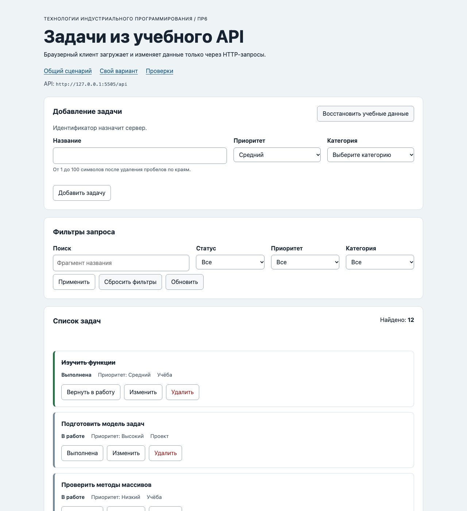

# Отчёт по практической работе № 6

**Тема:** Подключение браузерного приложения к API<br>
**Автор:** Бачинский Даниэль Денисович<br>
**Группа:** ЭФБО-06-25<br>
**Вариант:** 4

## 1. Цель работы

Связать браузерный интерфейс с учебным HTTP API: расширить клиент ПР5 методами `POST`, `PATCH`, `DELETE`, добавить предметные CRUD-операции, вывести асинхронные состояния списка (`loading`, `ready`, `empty`, `error`) и защитить интерфейс от устаревших ответов.

Результат: приложение получает задачи и категории только с сервера, создаёт, редактирует, переключает и удаляет задачи, после каждой мутации заново запрашивает список с текущими фильтрами. Проходят 70 проверок Node.js и 14 браузерных сценариев.

## 2. Запуск

**Версии:**

```text
node --version: v24.21.0
npm --version:  11.19.0
```

macOS Tahoe 26.6.2; браузер — Chromium 156.0.8078.75 (встроенный браузер), снимок экрана — Google Chrome headless.

**Команда запуска:**

```bash
npm start
```

**Адрес приложения:** `http://127.0.0.1:5506/` (вариант — `http://127.0.0.1:5506/?dataset=variant`)<br>
**Адрес API:** `http://127.0.0.1:5505/api`<br>
**Проверки:** `http://127.0.0.1:5506/checks.html`

Для ручной проверки «API не запущен → повтор» дополнительно использовался второй экземпляр API: `node api/server.mjs 5525` и адрес `http://127.0.0.1:5506/?api=http://127.0.0.1:5525/api`.



## 3. Реализация

### 3.1. HTTP-клиент

`src/api-client.js` перенесён из ПР5 (`buildUrl`, проверка `baseUrl`/`fetchFn`/`timeoutMs`, `ApiError`) и расширен:

- `requestJson(path, { method, query, body, signal, timeoutMs })`; допустимы только `GET`, `POST`, `PATCH`, `DELETE`, метод приводится к верхнему регистру, иначе `TypeError` до сети;
- `GET` с `body` отклоняется `TypeError`;
- `Accept: application/json` — всегда; `Content-Type: application/json` и `JSON.stringify(body)` — только если есть тело (у `GET`, `DELETE` и `POST /debug/reset` заголовка нет, лишнего preflight не возникает);
- тайм-аут `AbortSignal.timeout`, внешний сигнал объединяется через `AbortSignal.any`;
- `fetch` в отдельном `try`: отказ → `network` / `timeout` / `aborted`; дальше сначала `!response.ok` → `http` со `status`, `code`, `details`, `url`; затем `204` → `null`; затем `Content-Type` и `response.json()` → `invalid-response`.

### 3.2. Доменный API

`src/task-api.js`: `getTasks`, `getTaskById`, `getCategories`, `loadInitialData` (`Promise.all`), `createTask` (`POST /tasks`, в теле только `title`, `priority`, `categoryId`), `updateTask` (`PATCH /tasks/:id`), `setTaskCompleted` (`PATCH` с `{ completed }`), `deleteTask` (`DELETE`, ожидается строго `null`, иначе `invalid-response`), `resetDemoData` (`POST /debug/reset` без тела, ответ `{ reset: true, total }`). Последний аргумент каждого метода — `{ signal }`.

До запроса проверяются фильтры и `id` (`TypeError`). После запроса каждая задача проверяется `isTask`, категория — `isCategory`, у коллекций — уникальность `id` и `meta.total === data.length`. Значения полей черновика `createTask` не проверяет: это делает форма (`form-validation.js`) и повторно сервер (`VALIDATION_ERROR`, интеграционная проверка 09).

### 3.3. Состояния интерфейса

`src/app-controller.js` перед каждой загрузкой вызывает `setListState("loading")` (в DOM `aria-busy="true"`). После ответа: непустой список → `ready`, пустой → `empty` («По выбранным условиям задач нет.», старые карточки скрыты), ошибка → `error` с текстом `messageForError` и кнопкой повтора. Первая загрузка — `loadInitialData`; пока категории не получены (`categories === null`), и повтор, и смена фильтра снова вызывают `loadInitialData`; затем — `getTasks` с текущими фильтрами.

### 3.4. Изменение данных

Все мутации идут через внутреннюю `runMutation`: `setMutationPending(true)` → запрос к API → `notify(..., "success")` → повторный `GET /tasks` с текущими фильтрами → в `finally` `setMutationPending(false)`. При ошибке — `notify(messageForError(error), "error")`; если сервер вернул `VALIDATION_ERROR` с `details`, ошибки также показываются у полей формы.

- `submit(draft)` — `validateTaskDraft`; при ошибке запрос не отправляется; `editingId === null` → `createTask`, иначе `updateTask(editingId, value)`; после успеха форма возвращается в режим создания.
- `beginEdit(id)` / `cancelEdit()` — заполнение формы задачей из последнего ответа сервера и возврат.
- `toggleTask(id)` — `setTaskCompleted(id, !task.completed)`.
- `deleteTask(id)` — подтверждение спрашивает `dom-app.js`; удаление редактируемой задачи сбрасывает форму.
- `resetData()` — `resetDemoData` и перезагрузка текущей выборки.

Локальный массив не изменяется вручную, `localStorage` не используется: показывается только подтверждённое сервером состояние.

### 3.5. Защита от устаревшего ответа

В `loadCurrentTasks`: предыдущий `AbortController` отменяется (`abort()`), создаётся новый, номер загрузки увеличивается (`++loadSequence`). Результат применяется, только если номер совпадает с последним. Ошибка отменённой или устаревшей загрузки (`kind: "aborted"`) не показывается. Проверено: три подряд `applyFilters` → два первых `GET` в Network завершились `ERR_ABORTED`, отображён результат последнего (`completed=true&priority=high` → `[16, 25]`), сообщения об ошибке нет. Модульная проверка 27 подтверждает, что даже ответ, пришедший после отмены, не перезаписывает новый фильтр.

## 4. Индивидуальный вариант

**Начальный фильтр:** `priority=medium` (`variantNumber = 4` в `src/variant.js`)<br>
**Индивидуальный сценарий:** создать задачу среднего приоритета; карточка появляется в текущей выборке.

| Шаг | Действие | Ожидаемый результат | Фактический результат |
|---:|---|---|---|
| 1 | Сброс API, открыть `/?dataset=variant` | Фильтр «Приоритет: Средний», `GET /api/tasks?priority=medium`, id `[1, 10, 19, 28]` | Фильтр `medium`, id `[1, 10, 19, 28]`, «Найдено: 4» |
| 2 | Создать «Подготовить раздаточные материалы к семинару», приоритет «Средний», категория «Организация» | `POST /api/tasks` → 201, затем `GET /api/tasks?priority=medium`, новая карточка в выборке | `POST /api/tasks → 201 Created`, `GET /api/tasks?priority=medium → 200`; id `[1, 10, 19, 28, 35]`, «Найдено: 5», «Задача создана.» |
| 3 | Обновить страницу | Задача 35 осталась (хранится на сервере) | id `[1, 10, 19, 28, 35]` |

## 5. Результаты проверок

### 5.1. Автоматизированные проверки Node.js

`npm test`:

```text
Итог API: успешно 23, ошибок 0.
Итог модулей: успешно 33, ошибок 0.
Итог интеграции: успешно 14, ошибок 0.
```

Полные протоколы:

<details>
<summary>npm run check:api</summary>

```text
OK: 01. health возвращает JSON и заголовки CORS
OK: 02. исходный список содержит 12 задач в контрольном порядке
OK: 03. фильтры и поиск применяются совместно
OK: 04. неверный или повторяющийся query даёт 400
OK: 05. POST создаёт задачу, обрезает title и назначает id
OK: 06. созданная задача доступна по id и в списке
OK: 07. POST требует application/json
OK: 08. повреждённый JSON даёт структурированную ошибку
OK: 09. серверная валидация сообщает ошибки полей
OK: 10. PATCH изменяет только переданные поля
OK: 11. PATCH изменяет completed логическим значением
OK: 12. пустой PATCH и неизвестное поле отклоняются
OK: 13. DELETE возвращает 204 без тела
OK: 14. отсутствующая задача даёт 404 для PATCH и DELETE
OK: 15. неверный id даёт 400
OK: 16. категории доступны отдельным ресурсом
OK: 17. HEAD возвращает заголовки без тела
OK: 18. OPTIONS объявляет CORS для изменяющих методов
OK: 19. неподдерживаемый метод даёт 405 и Allow
OK: 20. отладочные маршруты воспроизводят виды ошибок
OK: 21. слишком большое тело запроса отклоняется
OK: 22. reset восстанавливает данные и счётчик id
OK: 23. два экземпляра API не делят изменяемое состояние

Итог API: успешно 23, ошибок 0.
```

</details>

<details>
<summary>npm run check:modules</summary>

```text
OK: 01. buildUrl соединяет baseUrl, путь и кодированный query
OK: 02. buildUrl не изменяет объект query
OK: 03. createApiClient проверяет конфигурацию
OK: 04. GET отправляет Accept, query и AbortSignal
OK: 05. POST сериализует тело и добавляет Content-Type
OK: 06. PATCH поддерживается, а неизвестный метод и body у GET отклоняются
OK: 07. успешный 204 преобразуется в null
OK: 08. JSON-ошибка HTTP сохраняет поля контракта
OK: 09. HTTP-ошибка важнее неверного Content-Type
OK: 10. неверный Content-Type и повреждённый JSON отклоняются
OK: 11. сетевая ошибка сохраняется как cause
OK: 12. тайм-аут отличается от внешней отмены
OK: 13. createTaskApi требует requestJson
OK: 14. getTasks нормализует фильтры и проверяет ответ
OK: 15. getTasks отклоняет неверные фильтры до запроса
OK: 16. loadInitialData параллельно запрашивает задачи и категории
OK: 17. createTask отправляет POST и проверяет задачу
OK: 18. update и смена статуса отправляют PATCH
OK: 19. deleteTask требует ответ 204, reset проверяет подтверждение
OK: 20. доменный API отклоняет неверную схему ответа
OK: 21. validateTaskDraft нормализует корректные данные
OK: 22. validateTaskDraft возвращает ошибки каждого поля
OK: 23. контроллер проверяет зависимости
OK: 24. start отображает loading, категории, задачи и ready
OK: 25. пустой ответ отображает состояние empty
OK: 26. ошибка загрузки отображается, а aborted не показывается
OK: 27. новая загрузка отменяет предыдущую и игнорирует устаревший ответ
OK: 28. невалидная форма не вызывает API
OK: 29. создание блокирует действия, очищает форму и обновляет список
OK: 30. редактирование, toggle и delete используют id текущей задачи
OK: 31. ошибка мутации показывается и снимает блокировку
OK: 32. reset вызывает сервер и перезагружает текущий фильтр
OK: 33. messageForError не раскрывает внутреннюю ошибку

Итог модулей: успешно 33, ошибок 0.
```

</details>

<details>
<summary>npm run check:integration</summary>

```text
OK: 01. начальная загрузка получает задачи и категории
OK: 02. клиент создаёт задачу и получает назначенный id
OK: 03. созданная задача читается по id
OK: 04. редактирование сохраняется на сервере
OK: 05. созданная задача находится серверным поиском
OK: 06. смена статуса видна через фильтр
OK: 07. DELETE удаляет запись и возвращает null
OK: 08. повторное удаление сохраняет код и детали 404
OK: 09. серверная ошибка валидации доступна клиенту
OK: 10. 204 не вызывает ошибку разбора JSON
OK: 11. реальная задержка прерывается по тайм-ауту
OK: 12. внешний AbortController отменяет реальный запрос
OK: 13. повреждённый JSON и text/plain определяются как invalid-response
OK: 14. reset восстанавливает исходный набор

Итог интеграции: успешно 14, ошибок 0.
```

</details>

`rg -n "TODO|Не реализовано" src` — совпадений нет.

### 5.2. Браузерные проверки

```text
OK: Карточка содержит безопасный текст и три действия
OK: Повторная отрисовка списка не накапливает карточки
OK: Начальная загрузка показывает 12 задач и 3 категории
OK: Фильтры формируют новый серверный запрос
OK: Поиск без результатов показывает empty, а сброс возвращает список
OK: Корректная форма создаёт задачу с серверным id
OK: Ошибки формы не отправляют запрос и связаны с полями
OK: Редактирование заполняет форму и сохраняет изменения
OK: Отмена редактирования возвращает режим создания
OK: Смена статуса подтверждается сервером
OK: Удаление подтверждается и сохраняется на сервере
OK: Сброс восстанавливает учебный набор
OK: Недоступный API показывает error и кнопку повтора
OK: Приложение не использует localStorage как источник данных

Всего: 14. Пройдено: 14. Ошибок: 0.
```

**Исправление в `checks/browser.checks.js`.** В исходной заготовке сценарий «Корректная форма создаёт задачу с серверным id» падал при любой реализации: `waitFor(() => requireNode(doc, '[data-task-id="35"]'))` — `requireNode` бросает исключение при первом же опросе, ещё до ответа сервера, и `waitFor` прерывается вместо ожидания. Первый прогон: «Всего: 14. Пройдено: 13. Ошибок: 1.» с сообщением «Не найден элемент: [data-task-id="35"]». Вручную задача 35 появлялась через ~100 мс. В проверке `requireNode` внутри `waitFor` заменён на `doc.querySelector` (возвращает `null`, пока карточки нет); утверждения и ожидаемый результат не менялись. После этого — 14/14.

### 5.3. Ручные проверки

| Сценарий | Ожидаемый результат | Фактический результат |
|---|---|---|
| API не запущен | Состояние ошибки и кнопка повтора | `?api=http://127.0.0.1:5525/api` без сервера: `data-kind="error"`, «Нет соединения с учебным API. Проверьте, запущен ли npm start.», кнопка «Повторить» видна |
| Повтор после запуска API | Данные загружаются | Запущен `node api/server.mjs 5525`, «Повторить» → `ready`, «Найдено: 12», в форме 3 категории + пустой пункт |
| Пустая выборка | Сообщение empty, список без старых карточек | Поиск «несуществующая»: `data-kind="empty"`, «По выбранным условиям задач нет.», «Найдено: 0», список скрыт |
| Двойное быстрое применение фильтров | Отображается результат последнего запроса | Три `applyFilters` подряд: `priority=low` и `priority=medium` — `ERR_ABORTED`, отображён `[16, 25]` для `completed=true&priority=high`, ошибок не показано |
| Ошибка формы | Запрос не отправляется, поля получают сообщения | Название «   », категория не выбрана: «Введите название задачи.», «Выберите категорию.», `aria-invalid="true"`; запросов `POST /api/tasks` — 0 |
| Создание и обновление страницы | Созданная задача остаётся на сервере | Задача 35 после перезагрузки страницы на месте (раздел 4) |
| Редактирование выполненной задачи | `completed` сохраняется | Задача 1 переименована в «Изучить функции и замыкания»; `GET /tasks/1` → `completed: true` |
| Смена статуса при активном фильтре | `PATCH`, затем повторный `GET` с фильтром; карточка уходит из выборки | Фильтр «В работе» `[4, 7, 13, 19, 22, 28, 34]` → «Выполнена» у 4: `PATCH /api/tasks/4 → 200 OK`, затем `GET /api/tasks?completed=false → 200 OK`; список `[7, 13, 19, 22, 28, 34]`, «Найдено: 6», «Задача № 4 выполнена.» |
| Отмена подтверждения удаления | Запрос не отправляется | `confirm` → «Отмена»: задача 10 осталась, список не изменился |
| Кнопка восстановления данных | Исходные 12 задач | «Исходный набор восстановлен.», id `[1, 4, 7, …, 34]` |
| Перезапуск API | Восстанавливается исходный набор | Создана задача 35 (всего 13) → API остановлен и запущен → всего 12, задачи 35 нет (данные в памяти) |

## 6. Ответы на контрольные вопросы

1. **Почему `fetch` не отклоняет Promise при ответе 404?**
   Сервер доступен и прислал полноценный HTTP-ответ — с точки зрения `fetch` обмен успешен. Promise отклоняется только при сетевой ошибке или отмене, поэтому статус проверяется явно через `response.ok`.
2. **Почему ответ 204 нельзя разбирать вызовом `response.json()`?**
   У 204 нет тела; `json()` попытается разобрать пустую строку и выбросит `SyntaxError`. Клиент возвращает `null` до проверки `Content-Type` и разбора.
3. **Чем состояние `empty` отличается от `error`?**
   `empty` — успешный ответ с пустым массивом (нормальный результат фильтра), показывается сообщение без кнопки повтора. `error` — запрос не выполнен (сеть, тайм-аут, HTTP-ошибка), данных нет, показывается причина и кнопка повтора.
4. **Зачем отменять предыдущий запрос при смене фильтров?**
   Иначе более старый и медленный ответ может прийти позже нового и перезаписать актуальную выборку. Отмена также освобождает сеть; номер загрузки дополнительно отбрасывает ответ, пришедший несмотря на отмену.
5. **Почему после мутации список повторно запрашивается у API?**
   Источник истины — сервер: он назначает `id`, `completed`, применяет фильтры. Повторный `GET` с текущими фильтрами показывает подтверждённое состояние — например, выполненная задача исчезает из фильтра «В работе».

## 7. Вывод

Интерфейс (`dom-app.js`) только читает поля и рисует; контроллер (`app-controller.js`) хранит снимок ответа, фильтры, `editingId` и управляет состояниями без обращения к `document`; предметный модуль (`task-api.js`) знает маршруты и схему; общий клиент (`api-client.js`) отвечает за HTTP, тело, статусы и вид ошибки. Все обращения идут через `createApiClient`, прямого `fetch` в контроллере нет.

Перенесённый из ПР5 клиент потребовал только расширения методами и телом. Найденная ошибка — в браузерной проверке заготовки (см. 5.2), а не в реализации; она исправлена без изменения ожидаемого результата.
