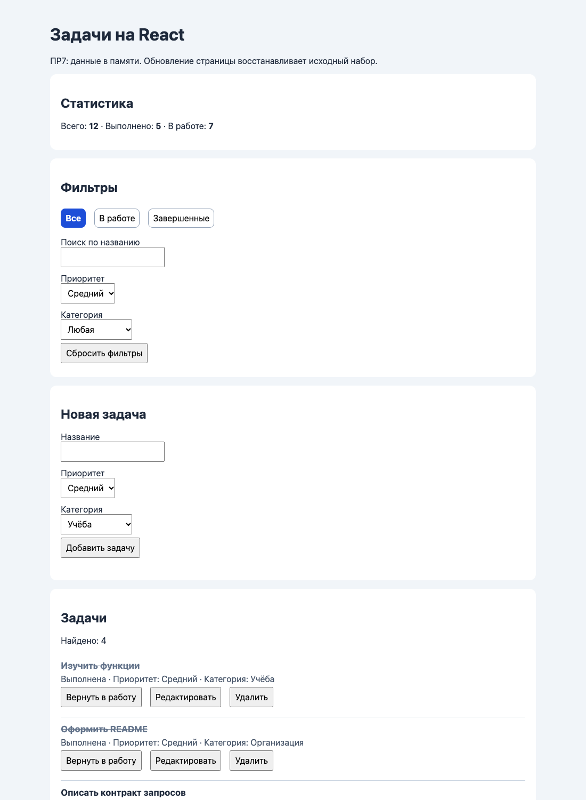

# ПР7. Создание компонентного интерфейса на React

- Автор: Бачинский Даниэль Денисович
- Группа: ЭФБО-06-25
- Вариант: 4 (начальный фильтр — средний приоритет)
- Node.js / npm: v24.21.0 / 11.19.0
- ОС / браузер: macOS Tahoe 26.6.2; Chromium 156 (встроенный браузер), Google Chrome headless для снимка

**Цель:** построить интерфейс из функциональных компонентов и управлять данными через `useState`.

## Запуск

Из папки `practice-07`:

```bash
npm ci
npm run dev
```

Адрес: http://127.0.0.1:5173/. Проверки: `npm test`. Сборка: `npm run build`. Просмотр сборки: `npm run preview` (http://127.0.0.1:4173/).

## Результат

Приложение показывает 12 задач и названия категорий, создаёт и редактирует задачи с проверкой полей, переключает статус, удаляет после подтверждения, применяет вместе поиск и фильтры статуса, приоритета и категории, показывает статистику по всему набору и число найденных записей. При пустой выборке выводится «Список задач пуст».

Данные живут в памяти страницы: перезагрузка возвращает исходные 12 задач и начальный фильтр варианта. Это ожидаемое ограничение ПР7 — сервер появится в ПР8.



## Компоненты и состояние

| Компонент | Ответственность |
|---|---|
| `App` | Владелец общего состояния: `tasks`, `filters`, `editingId`. Вычисляет `visibleTasks`, `stats`, `editingTask`, обрабатывает действия. |
| `TaskStats` | Показывает всего / выполнено / в работе по **полному** набору (`stats`). |
| `TaskFilters` | Управляемые фильтры: кнопки статуса «Все», «В работе», «Завершенные» (активная выделена синим фоном и `aria-pressed`), поиск, приоритет, категория и «Сбросить фильтры». Сообщает изменения через `onChange(nextFilters)`. |
| `TaskForm` | Хранит свой черновик `draft`, ошибки `errors` и сообщения. Проверяет ввод через `validateTaskDraft`, затем вызывает `onSave(value)`. |
| `TaskList` | Получает уже отфильтрованные `tasks`; при пустом массиве выводит «Список задач пуст», иначе рисует `TaskItem` через `.map` с `key={task.id}`. |
| `TaskItem` | Карточка: название, статус, приоритет, категория и три кнопки. Своей копии задачи не хранит. |

Данные идут вниз через props, действия — вверх через функции: карточка вызывает `onToggle(task.id)`, `onEdit(task.id)`, `onDelete(task.id)`, а `App` меняет массив.

**Производные данные.** `visibleTasks = selectTasks(tasks, filters)` и `stats = getTaskStats(tasks)` вычисляются при каждом рендере. Отдельных `useState` для них нет, поэтому список, счётчики и статистика не могут разойтись.

**Неизменяемые обновления.** Все изменения идут через функциональное обновление `setTasks(previous => …)` и чистые функции из `domain/task-service.js`: `map` с новым объектом `{ ...task, … }` для замены, `filter` для удаления, `[...tasks, item]` для добавления. Исходный массив заморожен, мутации не допускаются. Новый id — максимум **полного** массива + 1, вычисляется внутри обновления.

**Ключи.** У карточек `key={task.id}`: стабильный id, а не индекс, поэтому React правильно сопоставляет элементы при удалении.

**Сброс формы.** `<TaskForm key={editingId ?? 'new'} … />` — при смене редактируемой задачи форма монтируется заново и берёт новый начальный черновик. После успешного создания форма сама очищает черновик, после успешного редактирования `App` ставит `editingId = null`. `onSave` возвращает `true`/`false`; при `false` черновик сохраняется и показывается `role="alert"`.

**Подтверждение удаления** выполняется до `setTasks`, а не внутри функции обновления (StrictMode может вызывать её повторно). При удалении редактируемой записи `editingId` сбрасывается.

**Отличие от методички.** Фильтр статуса сделан группой из трёх кнопок вместо `select`. Это по-прежнему управляемое поле: значение берётся из `filters.completed` (`''`, `'false'`, `'true'`), нажатие вызывает `onChange`.

## Индивидуальный вариант

`src/variant.js`: `variant = 4` → начальный фильтр `priority: 'medium'`.

| Шаг | Ожидаемый результат | Фактический результат |
|---|---|---|
| Открыть приложение | Фильтр «Средний», видны задачи среднего приоритета | Приоритет «Средний», «Найдено: 4»: Изучить функции, Оформить README, Описать контракт запросов, Добавить фильтры API |
| Создать «Подготовить вопросы к семинару», приоритет «Средний» | Карточка появляется в выборке | «Найдено: 5», новая карточка последней, «Задача создана.», статистика 13 / 5 / 8, поле очищено |
| То же в `npm run preview` | Поведение как в dev | «Найдено: 4» → «Найдено: 5», карточка появилась |

## Автоматизированные проверки

`npm test`:

```text
ℹ tests 28
ℹ suites 0
ℹ pass 28
ℹ fail 0
ℹ cancelled 0
ℹ skipped 0
ℹ todo 0
```

`npm run build`:

```text
dist/index.html                   0.42 kB │ gzip:  0.30 kB
dist/assets/index-BwxSlUtw.css    1.00 kB │ gzip:  0.54 kB
dist/assets/index-CpZpSv2f.js   233.15 kB │ gzip: 72.85 kB
✓ built in 398ms
```

Исходно все 28 тестов падали с «Не реализовано». Один момент проверил отдельно: категория `'2x'` не должна приниматься как 2, поэтому строка проверяется регулярным выражением `/^[1-9]\d*$/`, а не `parseInt`.

## Ручные проверки

Шаг 1 методички: два временных `Counter` (`step` 1 и 5) после нажатий показали 1 и 10 — состояние независимо. Пример затем убран из `App`.

| № | Сценарий | Ожидаемый результат | Фактический результат |
|---:|---|---|---|
| 1 | Сбросить фильтры | 12 карточек; 12 / 5 / 7 | «Найдено: 12», «Всего: 12 · Выполнено: 5 · В работе: 7» |
| 2 | Название из пробелов | Ошибка, массив не меняется | «Введите название задачи.», `aria-invalid="true"`, ввод `"   "` сохранён, статистика 12 |
| 3 | 100, затем 101 символ | Первое принято, второе нет | 100 — создана (всего 13); 101 — «Название должно быть не длиннее 100 символов.», всего 13 |
| 4 | «  Новая задача  » | Пробелы убраны, в работе, форма очищена | «Новая задача», «В работе · Приоритет: Средний», поле пустое |
| 5 | Редактировать выполненную | Статус остаётся выполненным | «Изучить функции и замыкания»: «Выполнена · Приоритет: Высокий», форма вернулась к «Новая задача» |
| 6 | Правка A, затем «Редактировать» у B | Форма с данными B | Черновик «ЧЕРНОВИК A» пропал, форма «Редактирование задачи № 31», название «Сверить отчёт» |
| 7 | Изменить и отменить | Запись не изменилась | «Сверить отчёт» на месте, форма «Новая задача», поле пустое |
| 8 | Дважды переключить статус | Возврат к исходному | 5 → 6 → 5 выполненных |
| 9 | Отказ от удаления, затем подтверждение | Остаётся, затем удаляется | После отказа карточка есть, после подтверждения — нет |
| 10 | Удалить редактируемую запись | Форма → создание | Заголовок «Новая задача» |
| 11 | Все четыре фильтра | Только подходящие | «В работе» + Высокий + Проект + «подгот» → «Подготовить модель задач»; активна кнопка «В работе» (фон rgb(29, 78, 216)), «Все» — белая |
| 12 | Поиск без совпадений, сброс | Пустое состояние, затем весь список | «Найдено: 0», «Список задач пуст»; после сброса «Найдено: 12» |
| 13 | Создать неподходящую под фильтр | Счётчик вырос, карточки нет | Фильтр «Завершенные»: всего 12 → 13, карточка не показана |
| 14 | `` | Буквальный текст | Название показано как текст, элемента `img` нет, alert не сработал |
| 15 | Удалить всё, создать новую | Пусто, нули; создание работает | «Всего: 0 · 0 · 0», «Список задач пуст»; затем 1 / 0 / 1 |
| 16 | Перезагрузить страницу | Исходный набор и фильтр варианта | Приоритет «Средний», «Найдено: 4», 12 / 5 / 7 |
| 17 | Клавиатура | Видимый фокус, действия без мыши | Tab ×3 → кнопка «Завершенные» с синей рамкой `:focus-visible`; Enter активировал фильтр («Найдено: 2») |
| 18 | Вариант в preview | Как в dev | Совпадает (см. раздел варианта) |

В Console не было ошибок и предупреждений о ключах или uncontrolled/controlled.

## Контрольные вопросы

1. **JSX и HTML.** JSX — синтаксис JavaScript, который превращается в вызовы React; в нём `className`, `htmlFor`, выражения в `{}`, а текст экранируется автоматически.
2. **props и состояние.** Props приходят от родителя и только читаются; состояние принадлежит компоненту и меняется через `set…`.
3. **Обычная переменная.** Она создаётся заново при каждом вызове компонента и не вызывает перерисовку; `useState` сохраняет значение между рендерами и запрашивает обновление.
4. **Функциональное обновление** нужно, когда новое значение зависит от предыдущего: `setTasks(previous => …)`.
5. **Объект в копии массива.** Поверхностная копия оставляет те же объекты; изменение `next[0].completed` меняет и старое состояние.
6. **key.** Связывает элемент со своим состоянием; индекс сдвигается при удалении, и React перепутает элементы.
7. **Производные данные** не хранятся отдельно, чтобы не синхронизировать их вручную после каждого действия.
8. **Связь с родителем** — через функцию в props (`onToggle(id)`).
9. **Управляемое поле** получает `value` из состояния и меняет его через `onChange`.
10. **categoryId из select** приходит строкой, а в данных — число.
11. **Смена key** заставляет React смонтировать компонент заново с новым начальным состоянием.
12. **confirm вне обновления** — функция обновления должна быть чистой, StrictMode может вызвать её дважды.
13. **Пусто или нет совпадений** — по общей статистике: «Список задач пуст» при «Всего: 0» значит задач нет, при «Всего: 12» — их скрыл фильтр.
14. **npm test** проверяет чистые функции, но не React-компоненты, разметку и действия в браузере.
15. **ПР8**: заменить локальные `addTask`/`updateTask`/`removeTask` и `selectTasks` вызовами API, загрузить данные в эффекте, сделать `onSave` асинхронным.

## Вывод

Интерфейс собран из пяти компонентов с одним владельцем состояния `App`; фильтры, статистика и форма остаются согласованными, потому что всё производное вычисляется из `tasks` и `filters`. Проходят 28/28 тестов и сборка, ручной протокол 1–18 выполнен. Для ПР8 нужно перенести источник данных на сервер и сделать сохранение асинхронным.
