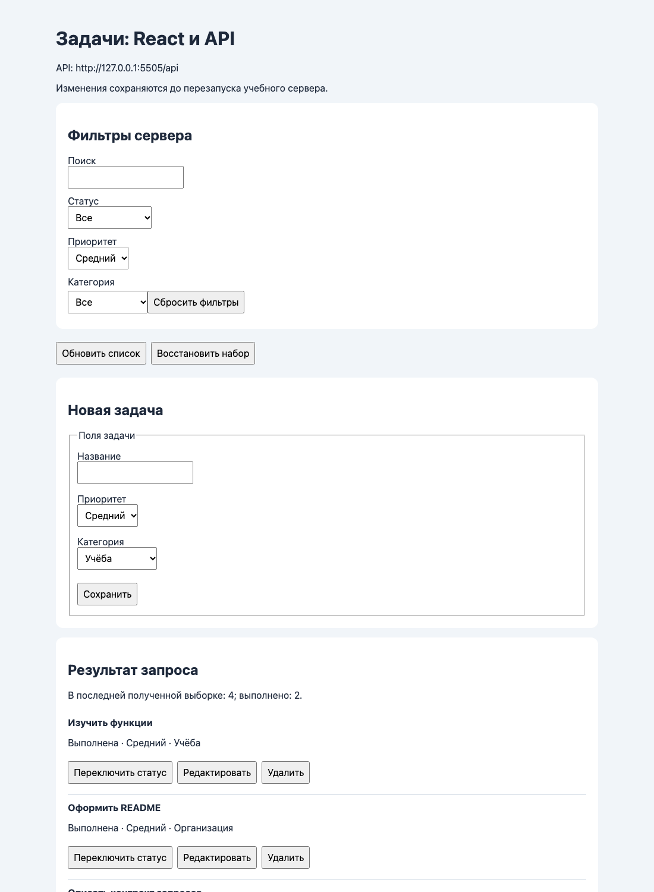

# ПР8. Работа React-приложения с API

- Автор: Бачинский Даниэль Денисович
- Группа: ЭФБО-06-25
- Вариант: 4 (начальный фильтр `priority=medium`)
- Node.js / npm: v24.21.0 / 11.19.0
- ОС / браузер: macOS Tahoe 26.6.2; Chromium 156 (встроенный браузер)

**Цель:** связать React-интерфейс с HTTP API: загрузка в эффекте при смене фильтров, очистка эффекта, операции изменения и повторный GET.

## Запуск

Из папки `practice-08`:

```bash
npm ci
```

Первый терминал:

```bash
npm run api
```

Второй терминал:

```bash
npm run dev
```

API: http://127.0.0.1:5505/api. Интерфейс: http://127.0.0.1:5173/. Сборка: `npm run build`, затем `npm run preview` (http://127.0.0.1:4173/), API при этом остаётся запущенным. Порты не менялись, `.env` не создавался.

## Полученный результат

Задачи и категории приходят с сервера, фильтры уходят в query-параметрах (`GET /api/tasks?priority=medium`). Создание, редактирование, смена статуса и удаление выполняются через API, после каждого подтверждённого изменения список запрашивается заново. Загрузка, пустой ответ и ошибка различаются; при ошибке обновления остаётся последний успешный снимок. Данные живут в памяти процесса API: перезагрузка страницы их не сбрасывает, перезапуск API — сбрасывает.



## Архитектура

| Часть | Ответственность |
|---|---|
| `components/*` | Фильтры, форма (асинхронный `onSave`), список карточек. Готовые из заготовки. |
| `App.jsx` | Хранит `filters`, снимок редактируемой задачи и сообщение; вызывает методы хука, подтверждает удаление. Берёт из хука `tasks`, `isLoading`, `snapshot`, `status`, `error`. |
| `hooks/useTaskData.js` | Моя реализация: загрузка в `useEffect`, отмена, защита от устаревших ответов, мутации, повторный GET. Управляет задачами (`snapshot.tasks` → `tasks`), признаком загрузки (`status` → `isLoading`) и ошибкой (`error`, отдельно `mutationError`). |
| `task-api.js` | Маршруты `/tasks`, `/categories`, проверка схемы; `loadInitialData` параллельно берёт задачи и категории. Готовый. |
| `api-client.js` | `fetch`, JSON, `ApiError`, тайм-аут и `AbortSignal`. Готовый. |
| `config.js` | Один объект `api` вне компонента — стабильная ссылка для зависимостей эффекта. |

**Эффект загрузки.** Зависимости: `api`, `q`, `completed`, `priority`, `categoryId`, `revision`. Поля фильтра извлекаются из объекта заранее, чтобы зависимостями были строки, а не новый объект. `snapshot`/`tasks` в зависимостях нет: это результат загрузки, иначе получился бы бесконечный цикл. Callback эффекта синхронный, внутри объявлена `async function load()`.

**Cleanup.** Сначала `active = false` (результат этого запуска больше не записывается), потом `controller.abort()`. Проверка `active` стоит и после успешного `await`, и в `catch` — запоздавшая ошибка тоже не показывается. Отменённый запрос (`signal.aborted`) пользователю как ошибка не выводится.

**Служебные ref.** `mountedRef` — признак монтирования (восстанавливается в setup отдельного эффекта, чтобы StrictMode корректно прошёл цикл setup → cleanup → setup). `mutationRef` — контроллер текущей мутации: ставится **до первого `await`**, поэтому второй синхронный вызов сразу получает `false`. Освобождается в `finally` только своим контроллером. Размонтирование отменяет и чтение, и текущую мутацию.

**Ошибка изменения и ошибка обновления.** `mutate()` возвращает `true` сразу после подтверждения POST/PATCH/DELETE и увеличивает `revision`. Новый GET выполняет эффект с **актуальными** фильтрами. Если этот GET не удался, это `error` (status `error`), а `mutationError` остаётся `null`. POST автоматически не повторяется. При ошибке самой мутации она сохраняется в `mutationError`, форма получает `false` и черновик остаётся.

**Отличия от ПР7.** Нет локального массива, `addTask`/`selectTasks` и назначения id — всё делает сервер; `onSave` возвращает `Promise<boolean>`; статистика — по последней полученной выборке (`meta.total`), а не по всей базе.

**Временный вывод для КР3.** Для скриншота в хук добавлялся эффект `console.log(isLoading, tasks.length)`. В консоли браузера при открытии было `true 0`, `true 0` (второй — повторный цикл StrictMode), затем `false 4` (вариант: 4 задачи среднего приоритета). После скриншота вывод удалён.

## Индивидуальный вариант

`src/variant.js`: `variant = 4` → фильтр `priority: 'medium'`.

| Действие | Метод и путь | Тело | Статус | Фактический результат |
|---|---|---|---|---|
| Открыть приложение | `GET /api/tasks?priority=medium`, `GET /api/categories` | — | 200, 200 | 4 задачи: Изучить функции, Оформить README, Описать контракт запросов, Добавить фильтры API |
| Создать «Подготовить вопросы к семинару», «Средний» | `OPTIONS /api/tasks` → `POST /api/tasks` | `{"title":"Подготовить вопросы к семинару","priority":"medium","categoryId":1}` | 204 → 201 | «Сохранено на сервере. Список обновляется.» |
| Повторная загрузка | `GET /api/tasks?priority=medium`, `GET /api/categories` | — | 200, 200 | Карточка появилась пятой, «В последней полученной выборке: 5» |

## Проверки

`npm test` (три набора):

```text
Итог API: успешно 23, ошибок 0.
Итог интеграции: успешно 14, ошибок 0.
ℹ tests 15
ℹ pass 15
ℹ fail 0
```

React-проверки:

```text
✔ 01. загрузка переходит из loading в ready
✔ 02. пустой успешный ответ остаётся ready
✔ 03. ошибка первой загрузки и успешный повтор
✔ 04. фильтры передаются API, прежний запрос отменяется
✔ 05. запоздавшая ошибка не портит свежий результат
✔ 06. ошибка обновления сохраняет последний снимок
✔ 07. StrictMode отменяет пробную загрузку, результат актуального эффекта принимается
✔ 08. размонтирование отменяет загрузку
✔ 09. создание идёт на сервер; затем повторяется текущий фильтр
✔ 10. ошибка мутации сохраняется отдельно, повтор разрешён
✔ 11. два синхронных вызова создают только одну мутацию
✔ 12. успешная запись не становится ошибкой мутации при неуспешном GET
✔ 13. toggle, delete и reset используют соответствующие методы
✔ 14. размонтирование отменяет мутацию и не запускает новый GET
✔ 15. смена фильтра во время мутации не отменяет запись; новый GET использует актуальный фильтр
```

Всего 52/52. В исходной заготовке не проходили все 15 React-проверок (`Не реализовано`).

`npm run build` — сборка без ошибок (`dist/assets/index-*.js` ≈ 236.6 kB, `✓ built`).

### Ручной протокол

| № | Сценарий | Ожидаемый результат | Фактический результат |
|---:|---|---|---|
| 1 | Открыть с работающим API, сбросить фильтры | 12 задач | 12, «В последней полученной выборке: 12; выполнено: 5.» |
| 2 | Открыть при выключенном API | Ошибка, есть «Обновить список» | «Не удалось обновить список: Сеть недоступна. …», кнопка доступна, в категориях только «Все» |
| 3 | Включить API, «Обновить список» | Задачи и категории получены | 4 задачи варианта, 3 категории, ошибок нет |
| 4 | Поиск без совпадений | Успешный GET, пустая выборка | 0 карточек, «По выбранным условиям задач нет.» |
| 5 | Быстрая смена фильтров при throttling | Старые ответы не заменяют новый | Не выполнено вручную (throttling во встроенном браузере недоступен); подтверждено тестами 04 и 05 |
| 6 | Пустое название | Ошибка формы, POST нет | `aria-invalid="true"`, «Название: от 1 до 100 символов.», запросов к API — 0 |
| 7 | Создать и обновить страницу | Задача сохранена | «Сохранится до перезапуска» есть после перезагрузки страницы |
| 8 | Двойное нажатие сохранения при медленной сети | Один POST | Не выполнено вручную (нет throttling); подтверждено тестом 11 — два синхронных вызова дают одну мутацию |
| 9 | Редактировать выполненную задачу | PATCH без completed, статус сохраняется | `PATCH /tasks/1`, затем GET; на сервере `completed: true`, новое название |
| 10 | Переключить статус при фильтре «В работе» | PATCH, затем GET с теми же условиями | `/tasks/4`, затем `/tasks?completed=false`; 7 → 6 карточек |
| 11 | Отказ от удаления, затем подтверждение | При отказе нет запроса; потом DELETE и GET | Отказ — запросов 0; подтверждение — `/tasks/7`, затем `/tasks?completed=false`, карточка исчезла |
| 12 | Выключить API и сохранить форму | Черновик сохраняется, ошибка изменения, блокировка снята | «Изменение не подтверждено: Сеть недоступна. …», поле сохранило текст, `pending` снят |
| 13 | Выключить API после загрузки, «Обновить список» | Последний снимок, ошибка, изменения отключены | Осталось 6 карточек, ошибка обновления, «Сохранить» и кнопки карточек `:disabled`, «Обновить список» доступна |
| 14 | Начать правку, скрыть запись фильтром | Черновик не теряется, сохранение по исходному id | Задача 19 скрыта фильтром «Высокий», черновик на месте; `PATCH /tasks/19` изменил название |
| 15 | `` | Буквальный текст | Показан как текст, `img` не создан |
| 16 | Перезапустить API | Исходный набор | После перезапуска `?priority=medium` снова 4 исходные задачи |
| 17 | Вариант и CRUD в preview | Как в dev | `http://127.0.0.1:4173/`: 4 → создание 5 → удаление 4 |

Дополнительную проверку с блокировкой `*/api/categories*` во встроенном браузере провести нельзя — это поведение подтверждено автоматическим тестом 12.

## Контрольные вопросы

1. **Эффект, а не тело компонента** — рендер должен быть чистым; запрос в теле повторялся бы на каждом рендере.
2. **Cleanup** вызывается перед повторным запуском эффекта при смене зависимостей и при размонтировании.
3. **Callback не async** — он должен вернуть функцию очистки, а не Promise.
4. **Зависимости:** `api`, четыре поля фильтра и `revision`. `snapshot` — результат загрузки; его смена не должна запускать новый GET.
5. **Стабильный api** — новый объект на каждом рендере менял бы зависимость и вызывал бесконечные запросы.
6. **Актуальность кроме abort** — реализация может проигнорировать signal и всё равно вернуть ответ.
7. **Защита в catch** — запоздавшая ошибка старого запроса иначе затёрла бы свежий результат.
8. **StrictMode** проверяет, что setup/cleanup симметричны: пробный запрос отменяется, актуальный завершается.
9. **pending в state** обновится только после рендера; два синхронных вызова увидят старое значение. Нужен ref до `await`.
10. **true при ошибке GET** — запись на сервере подтверждена, не удалось только обновить отображение.
11. **Без автоповтора POST** — сервер мог успеть создать запись, повтор даст дубликат.
12. **Смена фильтров не отменяет мутацию** — это отдельная операция пользователя; чтение и запись имеют разные контроллеры.
13. **После отмены ожидания** серверная операция может всё равно выполниться — это не откат.
14. **meta.total** — размер отфильтрованной выборки, а не всех записей.
15. **Не проверяется в jsdom:** настоящий CORS, внешний вид, работа формы с реальной сетью, Network и throttling.

## Вывод

Реализован хук `useTaskData`: загрузка в эффекте с правильными зависимостями, отмена и защита от устаревших ответов, немедленная блокировка мутаций через ref и раздельные ошибки записи и чтения. Проходят все 52 проверки, сборка и ручной протокол (сценарии 5 и 8 подтверждены тестами). При замене учебного API собственным сервером (ПР9–ПР10) клиент не меняется, если сервер соблюдает тот же контракт; потребуется только адрес в `VITE_API_URL`.
